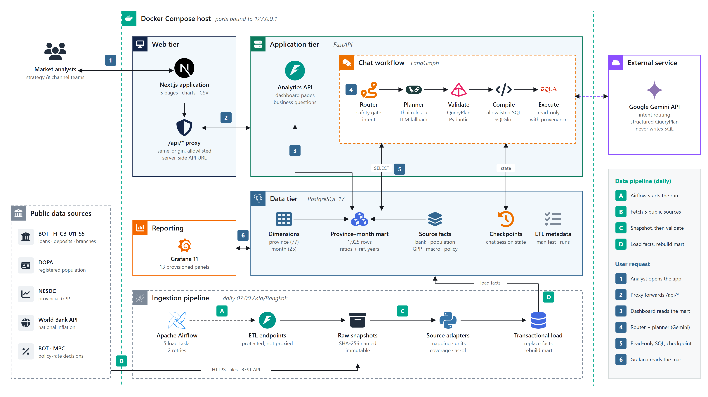

# Thailand Regional Banking Intelligence

A public-data analytics platform for comparing Thailand's provincial banking markets. It combines a PostgreSQL warehouse, daily ETL orchestration, a Next.js dashboard, Grafana reporting, and a bounded Gemini-powered analytical assistant.

Built for regional strategy and channel-planning research—not customer credit decisions, individual-bank analysis, or automated branch recommendations.

[ภาษาไทย](README_TH.md) · [Quick start](docs/getting-started.md) · [Documentation](docs/README.md) · [Business findings](docs/business-report.md)


## Business problem

Provincial loan balances alone are a poor basis for comparing markets: Bangkok dominates recorded balances, while provinces differ in population, economic scale, and branch coverage. The relevant publications also use different geographic names, reporting grains, units, and release dates.

This project maps five public sources into a province–month mart so a reviewer can compare market size, growth, and scale-adjusted measures with visible calculation rules and provenance. A shortlist is a starting point for further investigation, not evidence of unmet demand or profitability.

## What the application supports

- **Market overview:** national loan/deposit balances, branch counts, YoY changes, trends, and concentration.
- **Province analysis:** detailed histories, comparisons of up to four provinces, GPP context, and adjustable screening criteria.
- **Analytical assistant:** Thai questions, ratio-aware rankings, filters, comparisons, YoY, and follow-ups; capability guidance, grounded definitions, and chart/table changes.
- **Business questions:** ten predefined analyses with actual results, SQL, parameters, and interpretation.
- **Source quality:** coverage, reference periods, retrieval metadata, availability rules, and redacted ETL status.

The assistant uses Gemini to select a bounded conversational action when a key is configured. Analytical requests use a hybrid planner: known wording is resolved with semantic rules, unresolved paraphrases can use structured LLM output, and only validated plans reach read-only SQL. No-key mode remains usable with narrower offline routing and deterministic analytical coverage.

## Data and technology

Verified snapshot: **77 provinces × 25 months = 1,925 analytical rows**, covering **July 2024–July 2026**. These are dated observations, not a guarantee of current upstream freshness.

| Source | Ingestion | Purpose |
| --- | --- | --- |
| Bank of Thailand, FI_CB_011_S5 | Public web table over HTTP GET/form POST | Monthly loans, deposits, and branches |
| Department of Provincial Administration | Official TXT downloads | Annual registered population |
| NESDC | Official GPP workbook | Annual provincial economic context |
| World Bank Indicators | Public JSON REST API | National annual inflation context |
| Bank of Thailand MPC decisions | Official workbook | National policy-rate history |

The BOT adapters use published tables/workbooks, **not authenticated BOT REST APIs**. See [sources, units, mapping, and temporal joins](docs/data-sources.md).

| Layer | Implementation |
| --- | --- |
| Application | Next.js App Router, TypeScript, Recharts |
| API and ingestion | Python, FastAPI, pandas, SQLAlchemy, psycopg |
| Warehouse | PostgreSQL; dimensions, source-grain facts, province–month mart |
| Orchestration and reporting | Apache Airflow; Grafana with 13 provisioned panels |
| Assistant | Gemini via LangChain, LangGraph checkpoints, Pydantic plans, SQLGlot validation |
| Verification | pytest, independent arithmetic checks, authored LLM evaluation, timing/token telemetry |

## Architecture



Lettered steps (A–D) are the daily data pipeline; numbered steps (1–6) follow a user request. Source snapshots are hashed with SHA-256. Geographic mapping is explicit, annual data follows conservative availability rules, and unavailable values remain `NULL`. See [architecture and data model](docs/architecture.md) for the low-level view with routes, modules, tables, and database roles.

## Run locally

Prerequisite: Docker Desktop with Linux containers.

From the repository root in PowerShell:

```powershell
docker compose up -d --build postgres api web
docker compose exec api python -m bank.etl all
```

The import uses live public sources, requires internet access, and may take several minutes. Check its final status before using the dashboard. Open [the application](http://127.0.0.1:3000) or [API documentation](http://127.0.0.1:8000/docs).

For optional Gemini configuration, Grafana/Airflow setup, development, verification, and troubleshooting, follow the [setup guide](docs/getting-started.md). No LLM key is required to load data or explore the dashboards.

## Product views

| Provincial comparison and screening | Analytical assistant |
| --- | --- |
|  |  |

Additional captures: [province detail](output/playwright/nextjs-provinces.png), [business question](output/playwright/nextjs-questions.png), [source quality](output/playwright/nextjs-sources.png), [mobile overview](output/playwright/nextjs-mobile.png), and [Grafana](output/playwright/grafana-dashboard.png).

These captures document dated local builds. The latest conversational router was verified through HTTP integration checks; older assistant images do not demonstrate its newer behavior. Design concepts are labelled separately from working-product evidence.

## Verification

Local verification on **11 October 2026 (Asia/Bangkok)**:

- **170 Python tests passed**; TypeScript checks and the Next.js production build passed.
- An **80-question Thai regression corpus** passed offline status, plan, and independently calculated result checks.
- A separate **24-turn live Gemini planner comparison** evaluated rules-only, LLM-only, and hybrid planning on development/held-out splits.
- A **seven-turn service smoke test** exercised capability guidance, analysis, explanation, presentation changes, refusal, and context preservation.

The final hybrid planner passed 14/14 held-out turns, but used **zero LLM calls on that split**. That result measures deterministic coverage on a small authored corpus—not general Gemini accuracy. The LLM-only planner passed 6/14 held-out turns under the strict all-checks rubric. The newer conversation router is **not included** in those planner scores.

See [verification status](docs/verification.md), [evaluation methodology](docs/llm-evaluation.md), and [full results with retained failures](docs/evidence/llm/results.md).

## Scope and limitations

- This is a **local analytical prototype**, not a production banking platform. Compose services bind to loopback and use development credentials. Authentication, tenant ownership, rate limiting, and production retention controls are not implemented.
- Loan/deposit balances are month-end stocks: aggregate across provinces within a month, never sum across months. Per-person loans are not personal debt; branch density is not a complete measure of financial access.
- Bangkok may reflect head-office booking. Registered population is not the number of customers. GPP and banking balances have different reference periods; associations do not establish causation.
- The observed World Bank vintage is **8 October 2026**, later than all banking months in this snapshot. Conservative availability rules therefore leave historical inflation unavailable; archived publication vintages are not reconstructed.
- A 25-month warehouse history does **not** prove a month of continuous scheduled Airflow operation. That requires separate observed run history.
- LLM calls can send authored questions and conversation context to the configured provider. Checkpoints store chat history; starting a new conversation does not delete old checkpoints. Never enter customer data or secrets.

## Repository guide

```text
bank/                 ingestion, API, analytical compiler, assistant, telemetry
frontend/             Next.js application and same-origin API proxy
airflow/dags/         daily source-loading and mart-building DAG
db/                   development database bootstrap and read-only role
grafana/              provisioned datasource and dashboard definitions
sql/                  competency-question SQL
tests/                regression tests and labelled question fixtures
tools/                evidence export, evaluation, and log aggregation
docs/                 guides, design notes, dated verification, and raw reports
output/playwright/    selected working-application screenshots
```

Start with the [documentation index](docs/README.md). Future work is separated in the [roadmap](PROJECT_PLAN.md). See [contribution guidance](CONTRIBUTING.md) for verification and publishing evidence.

## Author

**Anupat Suttilert** — Fourth-year Data Science student at Thammasat University and aspiring Data Engineer.

[](https://www.linkedin.com/in/anupat-suttilert-888a73348)
[](https://github.com/anupat2046)
[](https://anupatsuttilert.com/)

Interested in reliable data pipelines, analytical data modeling, and AI-assisted analytics with verifiable results.

- **Project focus:** Integrating Thai public data into a province–month warehouse for banking-market analysis, with interactive dashboards and a validated analytical assistant.
- **Core stack in this project:** Python, SQL, PostgreSQL, Apache Airflow, FastAPI, Next.js, and Docker.
- **AI and reporting:** Gemini, LangChain, LangGraph, and Grafana.

## License

Project code is available under the [MIT License](LICENSE). Third-party datasets and dependencies retain their own licenses or published usage terms; the project license does not relicense provider data. See the [source catalogue](docs/data-sources.md).
