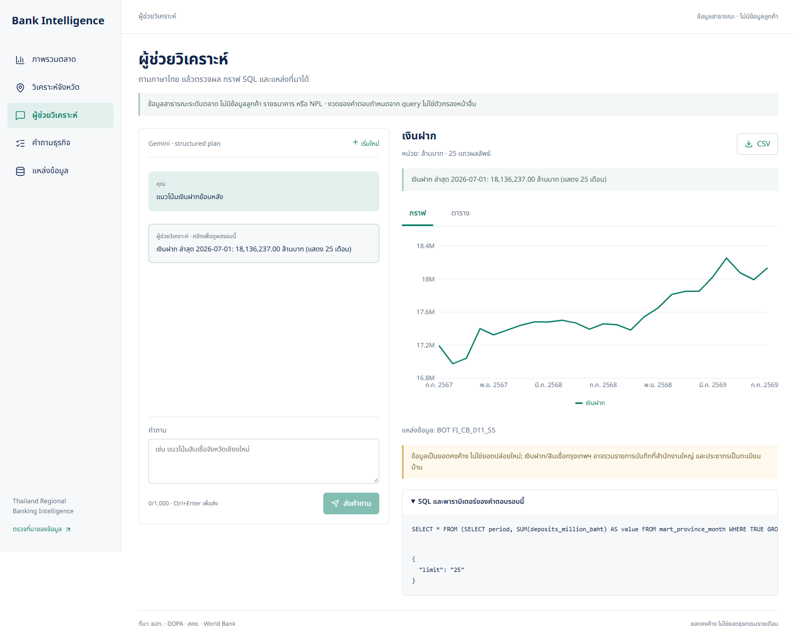

# Thailand Regional Banking Intelligence (ภาษาไทย)

โปรเจกต์ Data Warehouse + ETL + Dashboard + Chatbot สำหรับวิเคราะห์ภาพรวมธนาคารพาณิชย์รายจังหวัดไทยจาก **ข้อมูลสาธารณะจริง** ไม่ใช่ข้อมูลลูกค้าหรือข้อมูลจำลอง อ่าน [แผนฉบับเต็ม](PROJECT_PLAN.md) ควบคู่กับเอกสารนี้: แผนมีงานต่อยอดบางข้อที่ยังไม่ได้ทำ ส่วนเอกสารนี้ระบุสิ่งที่รันและตรวจจริงแล้ว

## อัปเดตหน้าเว็บ Next.js

ใช้ Next.js เป็น frontend เดียว เอกสารและภาพหน้าจอของแอปปัจจุบันอยู่ในส่วนนี้และหลักฐานด้านล่าง

หน้าเว็บหลักย้ายเป็น **Next.js + TypeScript** แล้ว เปิดที่ http://127.0.0.1:3000 มี 5 หน้า: ภาพรวมตลาด วิเคราะห์จังหวัด (รายละเอียด/เปรียบเทียบ/คัดกรอง) ผู้ช่วยวิเคราะห์ คำถามธุรกิจ และแหล่งข้อมูล. ตารางค้นหา/เรียง/ดาวน์โหลด CSV ได้ ตัวกรองเก็บใน URL และรองรับมือถือ. Backend, PostgreSQL, ETL, Grafana และ LangGraph ใช้ระบบเดิม. ดู [รายละเอียด frontend](frontend/README.md) และ [หลักฐานตรวจหน้าเว็บ](docs/evidence/nextjs-qa.md)

ชุดทดสอบ Python ล่าสุดผ่าน **170 รายการ** พร้อมตรวจ TypeScript และ production build. ชุดคำถามไทย 80 ข้อผ่านการตรวจแบบ offline ทั้งสถานะ แผน และผลคำนวณอิสระ ส่วน [การประเมิน Gemini จริง](docs/llm-evaluation.md) ใช้ชุดใหม่ 24 เทิร์น แยกพัฒนา/held-out เทียบ rules-only, LLM-only และ hybrid พร้อม [ผลก่อน–หลังและข้อมูลรายข้อ](docs/evidence/llm/results.md). ไม่ใช่การรับรองความแม่นยำทุกคำถาม. ระหว่างตรวจพบ World Bank vintage ใหม่วันที่ 8 ต.ค. 2569 อยู่หลังงวดธนาคารล่าสุด ก.ค. 2569 จึงไม่มีเงินเฟ้อที่ใช้ได้ใน mart ตามกติกาไม่มองอนาคต แม้นำเข้าข้อมูลต้นทาง 66 ปีสำเร็จแล้ว ระบบแสดง NULL ตามจริง ไม่สร้างวันที่เผยแพร่ย้อนหลัง


## หลักฐานการพัฒนาเดิม ณ 28 กันยายน 2569

อัปเดตสำหรับโจทย์ Project ใหม่เมื่อ **10 ต.ค. 2569**: มี 10 Competency Questions, SQL ทั้ง 10 ข้อพร้อมผลจริง, หน้า Prototype สำหรับดูคำตอบ และชุดทดสอบผ่าน **39 รายการ**. โจทย์ใหม่ไม่กำหนด scheduler ต่อเนื่องหนึ่งเดือน; ข้อกำหนดนั้นเป็น assignment เดิม

- PostgreSQL: 77 จังหวัด × 25 งวดรายเดือน (ก.ค. 2567–ก.ค. 2569) = 1,925 แถวใน `fact_bank_month` และ `mart_province_month`
- DOPA: ประชากรทะเบียนรายจังหวัด 3 ปี (2566–2568) = 231 แถว
- สศช.: GPP จังหวัดปี 2024p = 77 แถว
- World Bank Indicators **JSON API จริง**: เงินเฟ้อไทย 65 ปีที่มีค่า; metadata ล่าสุดของ API = 13 ก.ค. 2569
- ธปท. มติคณะกรรมการนโยบายการเงิน: 191 events จาก XLSX ทางการ (ไม่ใช่ BOT API); join อัตราล่าสุด ณ สิ้นเดือนโดยไม่มองล่วงหน้า
- Airflow DAG `bank_regional_daily`: ทดสอบรันครบ 6 งานแล้ว (BOT, DOPA, NESDC, World Bank API, MPC workbook, mart); ตั้งทำงานทุกวัน 07:00 Asia/Bangkok โดย `catchup=False` และเก็บ metadata ใน PostgreSQL ฐาน `airflow` แยกจากคลัง `bank`
- Competency Questions: [10 ข้อ พร้อม SQL และผลจริง](docs/competency-questions.md) ตรวจเมื่อ 10 ต.ค. 2569; มีหน้า Next.js “คำถามธุรกิจ” ให้เลือกดูผล ตาราง กราฟ และ SQL
- Grafana: 13 panels รวมความต่อเนื่อง YoY, GPP peer, policy context และ shortlist
- Next.js: ภาพรวม เปรียบเทียบจังหวัด/GPP scatter/คัดพื้นที่แบบปรับเกณฑ์ได้ ถามข้อมูล และตรวจแหล่งข้อมูล/ประวัติ ETL; หลักฐานการย้าย frontend ตรวจเมื่อ 10 ต.ค. 2569
- FastAPI + LangGraph: คำถามไทย → `QueryPlan` แบบจำกัด → SQL ที่คอมไพล์จาก KPI catalog → PostgreSQL role อ่านอย่างเดียว → ตาราง/กราฟ/SQL/provenance
- LangGraph checkpoints ลง PostgreSQL จริง; โหมดไม่มีคีย์ยังระบุชัดว่าเป็นกฎภาษาไทยที่ไม่ใช้ AI. **Gemini ทดลองสดผ่านหนึ่งคำถามเมื่อ 30 ก.ย. 2569** แต่ยังไม่ใช่การประเมินความแม่นยำครบชุด

ตัวเลขปัจจุบันในหน้าจอเป็นงวดล่าสุดที่ต้นทาง ธปท. เปิดเผย **ก.ค. 2569** ไม่ใช่วันที่วันนี้ การมีข้อมูลย้อนหลัง 25 เดือนยืนยันช่วงข้อมูลเกิน 1 เดือน แต่ยัง **ไม่ใช่หลักฐานว่า Airflow ทำงานต่อเนื่องครบ 1 เดือน**; ควรเก็บ run history จริงก่อนส่งงาน

## เริ่มใช้งาน

ต้องมี Docker Desktop ที่เปิดอยู่ แล้วรันใน PowerShell จากโฟลเดอร์นี้:

```powershell
docker compose up -d --build
```

เริ่มระบบครั้งแรกจะต้องโหลดข้อมูลจริง:

```powershell
py -3.13 -m venv .venv
.\.venv\Scripts\python.exe -m pip install -r requirements.txt
.\.venv\Scripts\python.exe -m bank.etl all
```

ถ้ามี Python เวอร์ชันอื่นที่แพ็กเกจรองรับ ใช้ `python -m venv .venv` ได้ จากนั้นเปิด:

| ระบบ | URL | หมายเหตุ |
|---|---|---|
| หน้าหลัก / chatbot | http://127.0.0.1:3000 | Next.js |
| API docs | http://127.0.0.1:8000/docs | FastAPI |
| Grafana | http://127.0.0.1:3001/d/thai-bank-regions | user `admin`, รหัส dev `bank_dev_password` |
| Airflow | http://127.0.0.1:8081 | user `admin`; ดูรหัสที่ Airflow สร้างด้วยคำสั่งด้านล่าง |

```powershell
docker exec bank-airflow-1 cat /opt/airflow/standalone_admin_password.txt
```

รหัสผ่านใน Compose เป็น **development-only** และพอร์ตผูกกับ `127.0.0.1` เท่านั้น ห้าม deploy อินเทอร์เน็ตด้วย config นี้ ให้เปลี่ยน secrets, TLS, network access และ Grafana admin ก่อนใช้ภายนอกเครื่อง

ถ้าอยากเปิดโหมด LLM ให้คัดลอก `.env.example` เป็น `.env` เฉพาะเมื่อยังไม่มีไฟล์ แล้วใส่ `GEMINI_API_KEY` ของตัวเอง จากนั้น `docker compose up -d --build api web` โปรเจกต์จะให้ LangChain ส่งคำถามไปยัง `GEMINI_MODEL` (ค่าเริ่มต้น `gemini-2.5-flash`) เพื่อสร้าง **structured QueryPlan**; โมเดลไม่ได้สร้างหรือรัน SQL อิสระ. อีกทางเลือกคือ `OPENAI_API_KEY` / `OPENAI_MODEL`; หากใส่สองคีย์พร้อมกัน Gemini จะถูกเลือกก่อน. Free tier มีโควตาและเงื่อนไขการใช้ข้อมูลของผู้ให้บริการ ห้ามใส่ข้อมูลลูกค้าจริงในคำถาม คีย์อยู่ฝั่ง Python ไม่ถูกส่งเข้า Next.js client

ตรวจสุขภาพและทดสอบ:

```powershell
Invoke-RestMethod http://127.0.0.1:8000/health
.\.venv\Scripts\python.exe -m pytest -q
docker exec bank-airflow-1 airflow dags list
docker exec bank-airflow-1 airflow dags list-runs -d bank_regional_daily --no-backfill
```

## ข้อมูลจริงและ join

| แหล่ง | ช่องทางที่รันจริง | grain / หน่วย | ลิงก์ต้นทาง |
|---|---|---|---|
| ธปท. FI_CB_011_S5 | official public web table ผ่าน HTTP GET + form POST; **ไม่เรียกว่า REST API** | จังหวัด–เดือน, เงินฝาก/สินเชื่อเป็นล้านบาท, สาขาเป็นแห่ง | [BOT table](https://app.bot.or.th/BTWS_STAT/statistics/BOTWEBSTAT.aspx?language=ENG&reportID=1008) |
| กรมการปกครอง | official `.txt` download (ปี พ.ศ. 2566–2568) | จังหวัด–ธันวาคม, จำนวนผู้มีชื่อในทะเบียน | [DOPA statistics](https://stat.bora.dopa.go.th/new_stat/webPage/statByYear.php) |
| สศช. | official XLSX sheet `PER CAPITA` | จังหวัด–ปี 2024p, GPP ราคาปัจจุบันล้านบาท | [NESDC workbook](https://www.nesdc.go.th/en/download/table-of-gross-regional-and-provincial-product-2024-excel/) |
| World Bank | **JSON REST API** indicator `FP.CPI.TOTL.ZG` | ประเทศไทย–ปี, เงินเฟ้อ CPI (%) | [World Bank API](https://api.worldbank.org/v2/country/THA/indicator/FP.CPI.TOTL.ZG?format=json&per_page=100) |
| ธปท. MPC | official XLSX workbook (ไม่ใช่ API) | วันที่มติ, อัตราดอกเบี้ยนโยบาย (%) | [BOT policy decisions](https://www.bot.or.th/en/our-roles/monetary-policy/mpc-publication/policy-interest-rate.html) |

ไฟล์ดิบถูกบันทึกใน `data/raw/<source>/<sha256>.<ext>` โดยไม่แก้ต้นฉบับ พร้อม URL, hash, วันดึง และจำนวนแถวใน `source_manifest` / `etl_run` การรันซ้ำเป็นการแทนชุด fact ของแต่ละ source **ใน transaction เดียว**; ถ้าดึง/parse/ตรวจคุณภาพไม่ผ่าน ชุดเดิมยังอยู่ และ log `failed`

Compose mount `./data:/app/data` ให้ไฟล์ดิบที่ Airflow สั่ง API ดึงอยู่ในโฟลเดอร์นี้แม้ recreate API container; warehouse และ Airflow metadata อยู่ใน Docker named PostgreSQL volume แยกกัน

การ map ใช้ [ตาราง crosswalk 77 จังหวัด](bank/provinces.py) จากชื่ออังกฤษ ธปท. และ สศช. ไปยังรหัสจังหวัด DOPA รวม Bangkok, Bueng Kan และสะกดที่ต่างกัน ไม่ fuzzy-join ชื่อที่ไม่รู้จัก และไม่รวม `Head office`, `Branches`, ภูมิภาค หรือ `Grand Total` ซ้ำกับจังหวัด

กฎเวลา:

- BOT เป็น **stock ณ งวดนั้น**: ห้ามบวกยอดข้ามเดือน; เฉพาะผลรวม 77 จังหวัดในงวดเดียว
- DOPA snapshot ธันวาคมของปีอ้างอิง ใช้ตั้งแต่เดือนมกราคมปีถัดไปเป็นต้นไปจนมี snapshot ใหม่; ไม่ถอยเอาประชากรอนาคตมาใช้กับเดือนก่อน
- NESDC ใช้ `Last-Modified` ของไฟล์ที่ตรวจได้ 31 มี.ค. 2569 เป็น availability floor; GPP 2024p จึงเป็น `NULL` ก่อนเดือน มี.ค. 2569 ไม่ใช่ศูนย์
- World Bank API ใช้ `lastupdated` จาก metadata เป็น availability floor; อัตราเงินเฟ้อรายปีเป็นบริบท **ระดับประเทศ** ที่ join ตามปีอ้างอิง ไม่ใช่อัตราเฉพาะจังหวัด
- BOT MPC workbook ใช้มติล่าสุดที่มีวันที่ไม่เกิน **สิ้นเดือนของงวดธนาคาร**; อัตรานี้เป็นบริบทระดับประเทศ ไม่ตีความความสัมพันธ์เป็นผลเชิงสาเหตุ
- ค่าจังหวัดที่เผยแพร่เป็นล้านบาทปัดเศษแล้ว จึงมีโอกาสที่ผลรวม 77 จังหวัดต่างจาก `Grand Total` ของ ธปท. เล็กน้อย (งวด ก.ค. 2569 ต่าง 4 ล้านบาทในเงินฝาก)

## Data model / KPI

`dim_province`, `dim_month` → `fact_bank_month` (จังหวัด–เดือน), `fact_population_year` (จังหวัด–ปี), `fact_gpp_year` (จังหวัด–ปี), `fact_macro_year` (ประเทศไทย–ปี), `fact_policy_event` (วันมติ) → `mart_province_month` (จังหวัด–เดือน). `source_manifest` และ `etl_run` เก็บ lineage/สถานะงาน

ดู [ER diagram และ data flow](docs/architecture.md)

| KPI | สูตร / ข้อควรระวัง |
|---|---|
| credit–deposit ratio | สินเชื่อ ÷ เงินฝาก × 100; ที่ระดับหลายจังหวัดคำนวณจากผลรวม ไม่เฉลี่ยเปอร์เซ็นต์รายจังหวัด |
| สาขาต่อประชากรแสนคน | สาขา ÷ ผู้มีชื่อในทะเบียน × 100,000; เป็น proxy ไม่ใช่ financial inclusion จริง |
| เงินฝากต่อคน | เงินฝาก (ล้านบาท) × 1,000,000 ÷ ผู้มีชื่อในทะเบียน; ไม่ใช่เงินฝากเฉลี่ยต่อผู้ฝากเงิน |
| YoY | (งวดล่าสุด ÷ เดือนเดียวกันปีก่อน − 1) × 100; panel 7–9 ทำจาก self-join |

คำถามใน Grafana: (1) สินเชื่อ/เงินฝากไปทางไหน (2) จังหวัดสินเชื่อสูงสุด (3) สาขาต่อประชากรสูงสุด (4) สินเชื่อต่อเงินฝาก (5) เงินฝากต่อคน (6) เงินเฟ้อไทยรายปีจาก API (7) สินเชื่อโต YoY สูงสุด (8) เงินฝากโตเร็วกว่าสินเชื่อเท่าไร (9) สาขาลดแต่สินเชื่อเพิ่มที่ไหน (10) ดอกเบี้ยนโยบายเปลี่ยนอย่างไร (11) GPP กับตลาดสินเชื่อแตกต่างกันไหม (12) จังหวัดไหนผ่านเกณฑ์คัดพื้นที่ (13) สินเชื่อ YoY เป็นบวกต่อเนื่องกี่เดือน. SQL ของทุก panel เก็บอยู่ใน [ไฟล์ dashboard](grafana/dashboards/regional-banking.json); อ่าน [รายงาน insight 7 ข้อ](docs/business-report.md)

## Chatbot และความปลอดภัยข้อมูล

Workflow: `plan` (กฎไทยที่ติดป้าย หรือ LangChain structured output สำหรับคำที่ยังแปลไม่ได้) → `execute` (Pydantic allowlist + SQL compiler + SQLGlot ตรวจ SELECT เดียวบน mart ที่อนุญาต) → `answer` → Next.js แสดงตาราง/กราฟ/SQL/provenance ผ่าน FastAPI. LangGraph ใช้ PostgreSQL checkpointer แยกตาม `session_id`. ใช้ PostgreSQL role `bank_reader` ที่มี SELECT แต่ไม่มี INSERT/UPDATE/DELETE; ETL ใช้ role `bank` อีกตัว. จำกัดผลจัดอันดับ 77 แถว และแนวโน้มไม่เกิน 77 งวด × 4 จังหวัด = 308 แถว ไม่เปิดให้โมเดลเขียน SQL ตรง ๆ. ไม่รองรับข้อมูลลูกค้า รายธนาคาร market share หรือ NPL

รองรับ 15 ตัวชี้วัด รวมสินเชื่อต่อประชากร/ต่อสาขา หลายตัวชี้วัด ตัวกรอง เทียบจังหวัด YoY และคำถามต่อเนื่อง เช่น `สินเชื่อต่อประชากรสูงสุด 10 จังหวัด พร้อมสินเชื่อต่อสาขาและ YoY` → `ไม่เอากรุงเทพฯ` → `เอา 5 อันดับ แล้วเทียบกับปีก่อน`. คำถามกำกวมถามกลับ ไม่แสดงผลเก่าแทนคำตอบใหม่ และกราฟแยกหน่วย. ดู [สูตร ขอบเขต ภาพหน้าจอ และผลตรวจ chatbot](docs/chatbot-analytics.md) พร้อมชุดคำถามไทย 80 ข้อและแผนที่คาดหวังใน `tests/fixtures/chat_cases.json`; ไม่ใช่ผลประเมิน LLM ทั้งชุด

## ข้อจำกัดและงานก่อนส่ง

1. ยังไม่มี **BOT Policy Rate API** เพราะต้องใช้ credentials; เราโหลดอัตรานโยบายจาก official XLSX ได้จริงและใช้ World Bank API เป็น API ที่รันสดแบบไม่ต้องมีคีย์ ถ้าอาจารย์ต้องการ **API จาก ธปท. โดยเฉพาะ** ต้องขอคีย์และทำ adapter เพิ่ม
2. Gemini มีผลประเมินสดก่อน–หลังบนชุดคำถามใหม่ 24 เทิร์น แยกชุดพัฒนา 10 และ held-out 14 รวมคำถามกำกวม สิ่งที่ข้อมูลตอบไม่ได้ และบทสนทนาต่อเนื่อง. ดูผลจริงในรายงาน ไม่ควรอ้างความแม่นยำทั่วไปจากชุดเล็กที่รันครั้งเดียว. OpenAI ยังไม่ได้ทดสอบสด
3. Airflow run สำเร็จในช่วงพัฒนาแล้ว แต่ยังต้องปล่อยให้รันจริงครบช่วงเวลาที่ assignment ระบุและเก็บ screenshot DAG + run history ต่อเนื่อง ห้ามกล่าวอ้างว่า scheduler รันมาแล้วหนึ่งเดือน; อย่าปิด Docker Desktop ระหว่างช่วงเก็บหลักฐาน
   ตั้งการตรวจติดตามใน Codex วันละครั้งไว้แล้วเพื่อแจ้งเมื่อ DAG ล้มเหลวหรือเมื่อถึง 28 ต.ค. 2569; การตรวจติดตามนี้ **ไม่ทำให้ Airflow รันแทน** หากเครื่อง/Docker ปิดอยู่ และต้องยืนยัน run history จริงก่อนส่ง
4. ข้อมูล ธปท. เป็นข้อมูลรวมของธนาคารพาณิชย์; กรุงเทพฯ อาจมีผลจากการบันทึกที่สำนักงานใหญ่ ข้อมูลนี้ใช้คัดพื้นที่เพื่อศึกษาเพิ่ม ไม่ใช่คำสั่งเปิดสาขา/อนุมัติสินเชื่อ
5. Password ใน Compose และ Airflow standalone เหมาะเฉพาะ local demo; หากนำขึ้น server ต้อง harden ใหม่ รวม RBAC, TLS, secret manager, audit/retention และ rate limiting

## หลักฐานและหน้าตา

- [ข้อกำหนดและแนวคิดหน้าจอ](docs/design/nextjs/design-spec.md) ภาพแนวคิดไม่ใช่หลักฐานข้อมูลจริง
- [ภาพรวมตลาด](output/playwright/nextjs-overview.png) · [หน้าจอมือถือ](output/playwright/nextjs-mobile.png)
- [รายละเอียดจังหวัด](output/playwright/nextjs-provinces.png) · [คัดพื้นที่และ GPP scatter](output/playwright/nextjs-screening.png)
- [Gemini ตอบจริงพร้อมกราฟ SQL และที่มา](output/playwright/nextjs-assistant.png) (10 ต.ค. 2569; ทดสอบหนึ่งคำถาม ไม่ใช่ผลวัดความแม่นยำ)
- [แหล่งข้อมูลและกติกา Join](output/playwright/nextjs-sources.png)
- [Grafana ภาพรวม](docs/evidence/grafana-qa.png), [ตัวชี้วัดและ API](docs/evidence/grafana-detail-qa.png), [YoY](docs/evidence/grafana-growth-qa.png), [Policy/GPP](docs/evidence/grafana-policy-qa.png), [ความต่อเนื่อง YoY](docs/evidence/grafana-new-panels-qa.png)
- [Airflow DAG 6 tasks สำเร็จ](docs/evidence/airflow-graph-qa.png)
- [สรุปผลตรวจและ Airflow run IDs](docs/evidence/run-status.md) · [รายงานธุรกิจและ 10 คำถาม](docs/business-report.md)
- [หลักฐาน 10 Competency Questions](docs/competency-questions.md) · [SQL ทั้ง 10 ข้อ](sql/competency_questions.sql) · [ภาพคำตอบ CQ10](output/playwright/nextjs-questions.png)

Design comparison ของ Next.js: sidebar 5 หมวด, white/navy/teal, 3 KPI พร้อม YoY, กราฟและตารางจาก warehouse จริง, ตัวเลือกงวด, provenance และ responsive layout. ดูรายละเอียดการตรวจและความแตกต่างจากภาพแนวคิดใน [ผลตรวจ frontend](docs/evidence/nextjs-qa.md)



## อัปเดตการเลือกเส้นทางบทสนทนา

ผู้ช่วยใช้ Gemini แยกประเภทคำถามก่อนวางแผนวิเคราะห์ รองรับการแนะนำความสามารถ ทักทาย อธิบายนิยามผลล่าสุด และเปลี่ยนกราฟ/ตารางจากผลเดิมโดยไม่ค้นข้อมูลใหม่ คำถามข้อมูลยังผ่าน hybrid planner และ SQL แบบ read-only ที่ตรวจสอบแล้ว ข้อผิดพลาดของผู้ให้บริการและคลังข้อมูลแสดงข้อความแยกกัน ชุดทดสอบหลังเพิ่ม router ผ่าน **170 รายการ** อ่านรายละเอียดและข้อจำกัดใน [conversation routing](docs/conversation-routing.md) ผล benchmark planner เดิมไม่ได้วัด router ใหม่นี้
