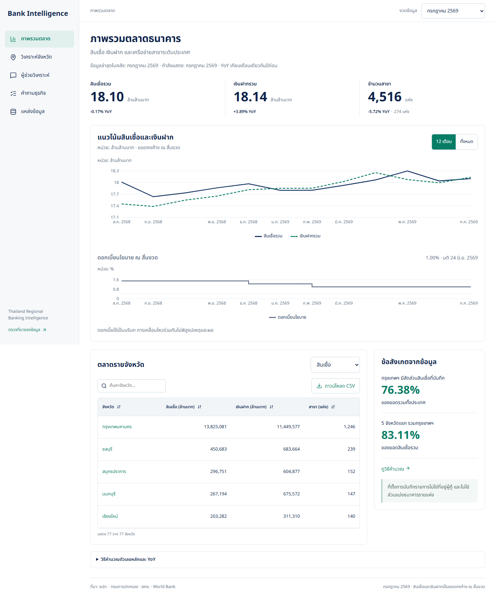
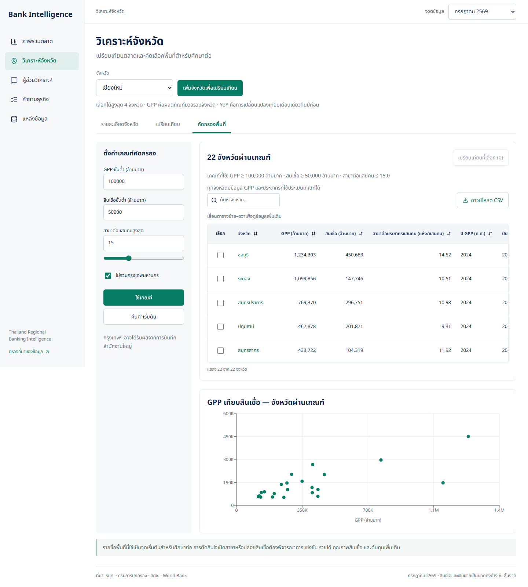
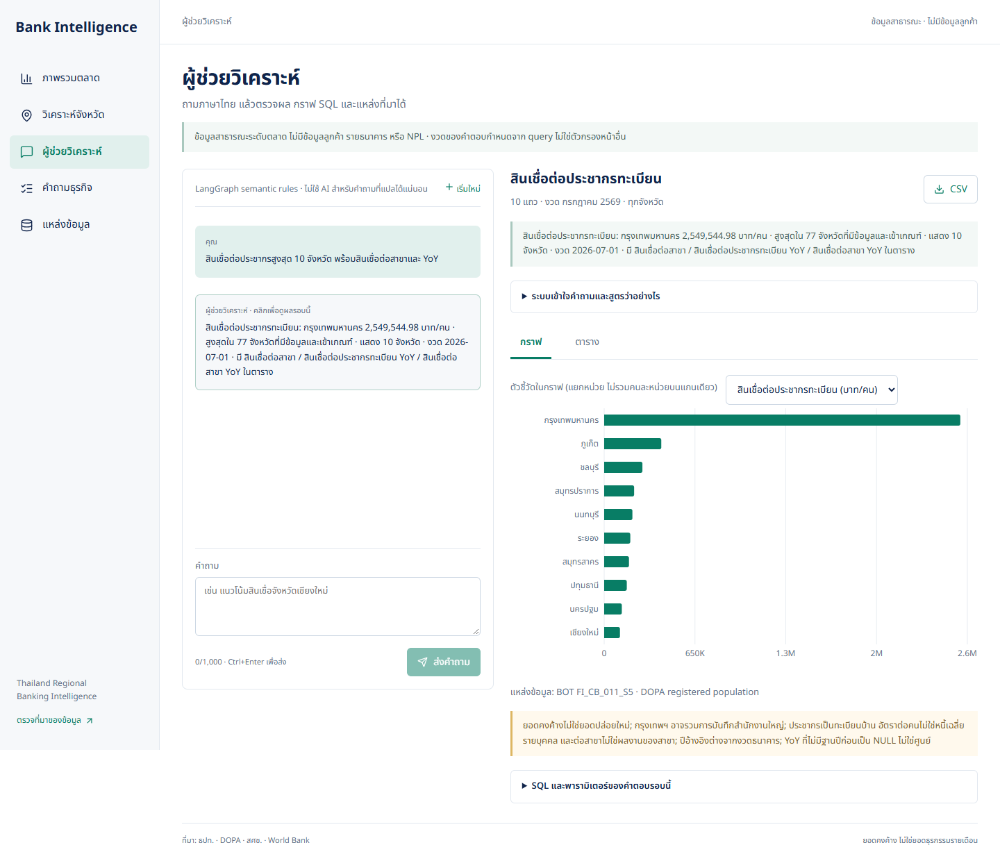

# Thailand Regional Banking Intelligence

ระบบวิเคราะห์ตลาดธนาคารพาณิชย์รายจังหวัดจากข้อมูลสาธารณะจริง ประกอบด้วย PostgreSQL warehouse, ETL ที่จัดตารางด้วย Airflow, เว็บ Next.js, Grafana และผู้ช่วยวิเคราะห์ที่เลือกเส้นทางบทสนทนาด้วย Gemini

ใช้ประกอบการศึกษาตลาดของทีมกลยุทธ์และวางแผนช่องทาง ไม่ใช่ระบบอนุมัติสินเชื่อ วิเคราะห์ลูกค้ารายบุคคล หรือแนะนำเปิด/ปิดสาขาอัตโนมัติ

[English](README.md) · [คู่มือเริ่มต้น](docs/getting-started.md) · [สารบัญเอกสาร](docs/README.md) · [รายงานธุรกิจ](docs/business-report.md)



## ปัญหาธุรกิจ

ยอดสินเชื่อรวมเพียงอย่างเดียวทำให้กรุงเทพฯ เด่นกว่าจังหวัดอื่น ขณะที่แต่ละจังหวัดมีประชากร ขนาดเศรษฐกิจ และเครือข่ายสาขาต่างกัน ข้อมูลที่ใช้เปรียบเทียบมาจากหลายหน่วยงาน ซึ่งมีชื่อจังหวัด หน่วย ความถี่ และเวลาประกาศไม่ตรงกัน

โครงการนี้ map ข้อมูลเข้าสู่ mart ระดับจังหวัด–เดือน เพื่อเปรียบเทียบขนาดตลาด การเติบโต และตัวชี้วัดต่อประชากร/ต่อสาขา พร้อมตรวจสูตรและที่มาได้ รายชื่อที่ผ่านเกณฑ์คัดกรองเป็นจุดเริ่มต้นของการศึกษาเพิ่ม ไม่ใช่ข้อพิสูจน์ว่าพื้นที่ขาดบริการหรือทำกำไรได้

## สิ่งที่ใช้งานได้

| ส่วน | ความสามารถ |
| --- | --- |
| ภาพรวมตลาด | สินเชื่อ เงินฝาก สาขา YoY แนวโน้ม และการกระจุกตัว |
| วิเคราะห์จังหวัด | ประวัติรายจังหวัด เปรียบเทียบสูงสุด 4 จังหวัด GPP และเกณฑ์คัดพื้นที่ |
| ผู้ช่วยวิเคราะห์ | ถามภาษาไทย จัดอันดับด้วย metric ที่ชัดเจน กรองข้อมูล เปรียบเทียบ ดู YoY และถามต่อ |
| บทสนทนา | แนะนำความสามารถ อธิบายนิยามผลล่าสุด และเปลี่ยนกราฟ/ตารางจากผลเดิม |
| คำถามธุรกิจ | 10 คำถาม พร้อมผลจริง SQL พารามิเตอร์ และข้อควรระวัง |
| แหล่งข้อมูล | Coverage ปีอ้างอิง เวลาดึง กฎ availability และสถานะ ETL ที่ตัดรายละเอียดภายใน |

เมื่อมีคีย์ Gemini จะเลือกประเภทคำถามก่อนส่งไปขั้นตอนที่เหมาะสม คำถามวิเคราะห์ใช้ hybrid planner: กฎสำหรับคำที่เข้าใจได้แน่นอน และ structured LLM สำหรับสำนวนที่ยังแปลไม่ได้ ทุกแผนต้องผ่าน validation ก่อนอ่าน SQL แบบ read-only หากไม่มีคีย์ ยังใช้ dashboard และการวิเคราะห์แบบกฎได้ โดยการตีความบทสนทนาจะจำกัดกว่า

## ข้อมูลและเทคโนโลยี

Snapshot ที่ตรวจ: **77 จังหวัด × 25 เดือน = 1,925 แถว** ตั้งแต่ **กรกฎาคม 2567–กรกฎาคม 2569** ไม่ใช่การรับรองว่าข้อมูลต้นทางล่าสุด ณ ทุกวันที่เปิดอ่าน

- ธปท. FI_CB_011_S5: ตารางเว็บทางการ สำหรับสินเชื่อ เงินฝาก และสาขารายเดือน
- กรมการปกครอง: TXT ทางการ สำหรับประชากรทะเบียนรายปี
- สศช.: Workbook สำหรับ GPP รายจังหวัด
- World Bank: JSON REST API สำหรับเงินเฟ้อไทยรายปี
- ธปท. MPC: Workbook มติอัตราดอกเบี้ยนโยบาย ไม่ใช่ BOT Policy Rate REST API

อ่าน [แหล่งข้อมูล หน่วย mapping และ temporal joins](docs/data-sources.md)

Stack หลัก: Next.js + TypeScript + Recharts, Python + FastAPI, PostgreSQL, Airflow, Grafana, LangChain + LangGraph, Pydantic และ SQLGlot ดู [สถาปัตยกรรมและ data model](docs/architecture.md)

## เริ่มใช้งาน

ติดตั้ง Docker Desktop ที่ใช้ Linux containers แล้วรันจาก root ของ repository ใน PowerShell:

```powershell
docker compose up -d --build postgres api web
docker compose exec api python -m bank.etl all
```

การโหลดครั้งแรกต้องใช้อินเทอร์เน็ตและอาจใช้เวลาหลายนาที ตรวจว่าทุกขั้นสำเร็จก่อนใช้งาน เปิด [เว็บแอป](http://127.0.0.1:3000) หรือ [API docs](http://127.0.0.1:8000/docs)

รายละเอียดการตั้งคีย์ Gemini, เปิด Grafana/Airflow, พัฒนา และแก้ปัญหาอยู่ใน [คู่มือเริ่มต้น](docs/getting-started.md) การโหลดข้อมูลและดู dashboard ไม่ต้องใช้คีย์ LLM

## ภาพประกอบ

| คัดพื้นที่ศึกษา | ผู้ช่วยวิเคราะห์ |
| --- | --- |
|  |  |

ดูเพิ่มเติม: [รายละเอียดจังหวัด](output/playwright/nextjs-provinces.png), [คำถามธุรกิจ](output/playwright/nextjs-questions.png), [แหล่งข้อมูล](output/playwright/nextjs-sources.png), [มือถือ](output/playwright/nextjs-mobile.png), [Grafana](output/playwright/grafana-dashboard.png)

ภาพเป็นหลักฐานของ build ตามวันที่ระบุ ไม่ใช่สถานะสด ภาพผู้ช่วยเดิมไม่ได้ยืนยันความสามารถ router รุ่นใหม่ ซึ่งตรวจแยกด้วย HTTP integration test ส่วนภาพแนวคิด UI ไม่ใช่ภาพผลิตภัณฑ์ที่ทำงานจริง

## ผลตรวจ

ผลตรวจในเครื่องวันที่ **11 ตุลาคม 2569 (Asia/Bangkok)**:

- Python **170 tests ผ่าน**, TypeScript check และ Next.js production build ผ่าน
- ชุด regression ภาษาไทย **80 ข้อ** ผ่านแบบ offline ทั้งสถานะ แผน และผลคำนวณอิสระ
- ทดสอบ planner ด้วย Gemini จริงบนชุดใหม่ **24 เทิร์น** แยก development/held-out และเปรียบเทียบ rules-only, LLM-only, hybrid
- ทดสอบบทสนทนาจริง **7 เทิร์น** ครอบคลุมแนะนำความสามารถ วิเคราะห์ อธิบาย เปลี่ยนกราฟ ปฏิเสธข้อมูลที่ไม่มี และรักษาบริบท

Hybrid ผ่าน held-out 14/14 แต่ **ไม่ได้เรียก LLM ใน split นี้** จึงไม่ใช่ Gemini แม่นยำ 100% ส่วน LLM-only ผ่าน 6/14 ตาม rubric แบบเข้มงวด ผล planner ไม่รวม router บทสนทนาที่เพิ่มภายหลัง

อ่าน [สถานะการตรวจ](docs/verification.md), [วิธีประเมิน](docs/llm-evaluation.md), และ [ผลเต็มที่เก็บข้อผิดพลาดไว้](docs/evidence/llm/results.md)

## ขอบเขตและข้อจำกัด

- เป็น local prototype ไม่ใช่ระบบธนาคาร production; Compose ผูกกับ loopback และใช้ credentials สำหรับพัฒนา ยังไม่มีระบบยืนยันตัวตน สิทธิ์เจ้าของ session หรือ retention สำหรับหลายผู้ใช้
- ยอดสินเชื่อ/เงินฝากเป็น stock ณ สิ้นงวด รวมจังหวัดภายในเดือนเดียวได้ แต่ห้ามบวกข้ามเดือน ตัวชี้วัดต่อคนไม่ใช่หนี้ส่วนบุคคล และจำนวนสาขาไม่ใช่ financial access ทั้งหมด
- กรุงเทพฯ อาจได้รับผลจากการบันทึกสำนักงานใหญ่ ประชากรทะเบียนไม่ใช่จำนวนลูกค้า GPP กับยอดธนาคารต่างปี และความสัมพันธ์ไม่ยืนยันเหตุและผล
- World Bank vintage ที่ตรวจคือ 8 ต.ค. 2569 อยู่หลังงวดธนาคารทั้งหมดใน snapshot จึงแสดงเงินเฟ้อย้อนหลังเป็น unavailable ตามกฎ conservative availability ไม่เติมศูนย์หรือสร้างวันเผยแพร่ย้อนหลัง
- ข้อมูลย้อนหลัง 25 เดือนไม่พิสูจน์ว่า Airflow รันต่อเนื่องหนึ่งเดือน ต้องตรวจ scheduled run history จริงแยกกัน
- คำถามและบริบทอาจถูกส่งไปผู้ให้บริการ LLM; checkpoints เก็บประวัติ การเริ่มใหม่ไม่ลบ session เก่า ห้ามใส่ข้อมูลลูกค้าหรือ secrets

เอกสารหลักใช้ภาษาอังกฤษ โดยเก็บตัวอย่างคำถามและผลจังหวัดภาษาไทยตามแอป ดู [สารบัญ](docs/README.md), [roadmap](PROJECT_PLAN.md) และ [แนวทาง contribution](CONTRIBUTING.md)

## License

โค้ดโครงการใช้ [MIT License](LICENSE) ส่วนข้อมูลและ dependencies จากภายนอกยังอยู่ภายใต้ license หรือเงื่อนไขของผู้เผยแพร่ต้นทาง ไม่ได้รับสิทธิ์ใหม่จาก license ของโครงการ ดู [source catalogue](docs/data-sources.md)
