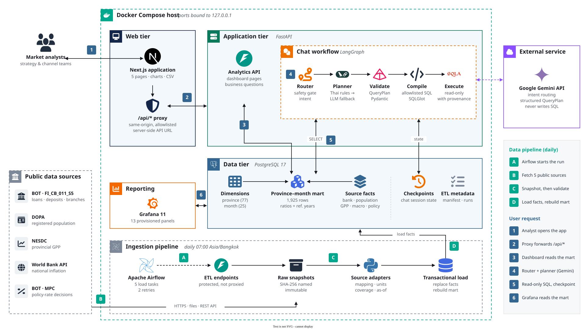
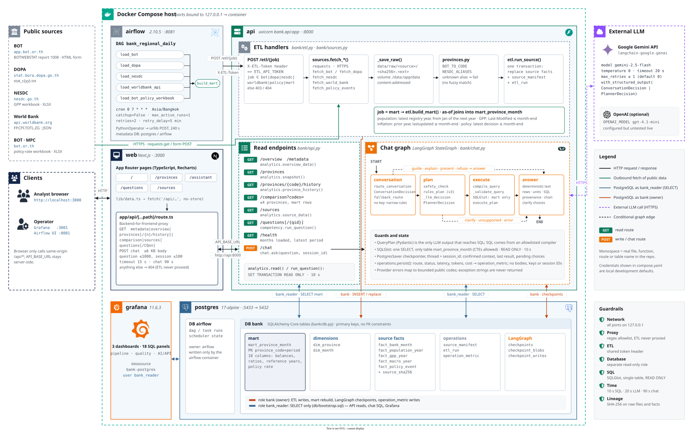
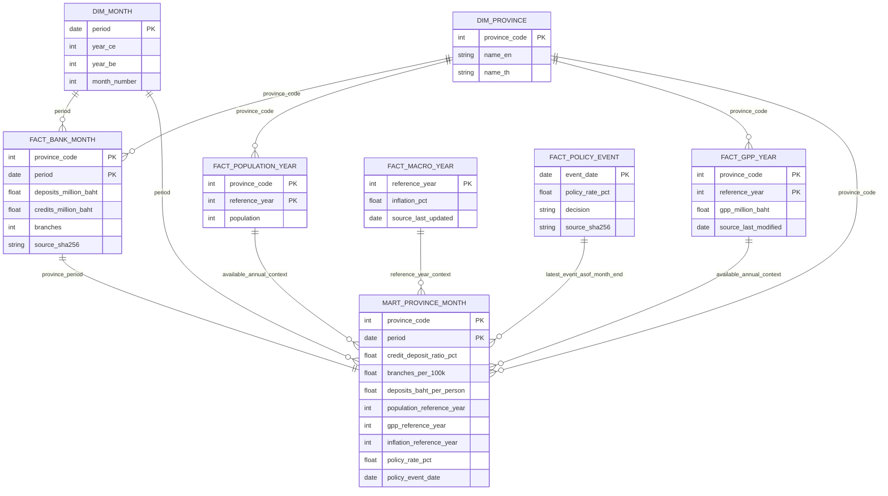
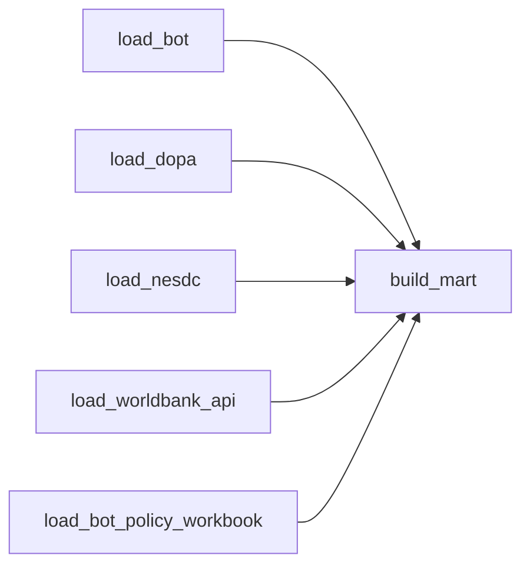

# Architecture and data model

[Documentation index](README.md) · [Sources and temporal joins](data-sources.md) · [Assistant contract](chatbot-analytics.md)

## System boundaries

Grafana now reads ETL records, current warehouse-quality checks, and allowlisted
`operation_metric` rows using `bank_reader`. Next.js retains business analysis.
The API writes best-effort metrics using the owner role. See [operational monitoring](operations.md).

### High-level view



### Low-level view



The low-level view names real files, functions, routes, and tables; open the [image](design/system-architecture-low-level.drawio.svg) to zoom. Orange database connections use the owner role `bank` (ETL writes, mart rebuild, chat checkpoints); blue connections use the SELECT-only role `bank_reader` (API reads, chat SQL, Grafana).

Diagrams in `docs/design/*.drawio.svg` are editable draw.io files that also render as images. Open them in [draw.io](https://app.diagrams.net/) or the VS Code Draw.io Integration extension and save in place; there is no separate source file.

The browser accesses same-origin `/api/*`. The Next.js server forwards allowlisted analytical endpoints and chat to FastAPI; it does not proxy privileged ETL routes or arbitrary destinations. `API_BASE_URL` is server-side. Compose publishes ports on loopback.

## Data model

The diagram below describes **logical join relationships**, including as-of annual/event joins. The SQLAlchemy schema defines primary keys but does not declare these relationships as database foreign-key constraints. ETL validates geographic coverage and mart row preservation.



| Layer | Responsibility |
| --- | --- |
| Raw files | Immutable content-addressed source snapshots under `data/raw/<source>/<sha256>.<ext>` |
| Dimensions | Conformed province codes and banking months |
| Source-grain facts | Banking month, population/GPP year, national macro year, policy event date |
| Analytical mart | One row per province and banking month; ratios and context reference fields |
| Operational metadata | `source_manifest` records URLs, retrieval, hashes, and raw paths; `etl_run` records source/job outcomes |

Fact loads replace each source's current fact set transactionally; raw snapshots retain source contents. This is not a full slowly changing warehouse or archived historical-publication-vintage model. Unknown province aliases fail validation rather than using fuzzy matching.

## ETL orchestration



The five source tasks feed the mart task. The DAG uses `catchup=False`, `max_active_runs=1`, and two task retries with a five-minute delay. Airflow metadata is stored in the separate `airflow` database in the development PostgreSQL service.

Daily polling checks for new publications/revisions; observations retain their original reporting grain. A run schedule is configuration, not proof of actual continuous execution.

## Analytical execution

Reads use `bank_reader`, read-only transactions, bound parameters, and a ten-second statement timeout. Requested months must exist in the warehouse. Competency questions are scoped to the selected month; province comparisons accept up to four codes. Public source responses omit internal raw paths and raw ETL errors.

The analytical compiler permits catalogued measures and dimensions only. SQLGlot checks a single read-only SELECT over the allowed mart. A query limit bounds returned rows but does not by itself bound scan cost; the timeout provides a separate execution limit.

## Conversation workflow

```text
START → conversation
           ├─ capabilities / greeting → catalogue response
           ├─ explanation → definitions and caveat from last confirmed result
           ├─ presentation → copy last result, change validated chart kind
           ├─ clarification / unsupported → safe no-result response
           └─ analytics → hybrid plan → validated execution
                                      ↓
                              grounded answer → END
```

Safety checks precede model routing. Gemini chooses a bounded action when configured; narrow offline routing remains available. The hybrid analytical planner resolves known wording through semantic rules, with structured-LLM fallback for unresolved paraphrases. Only a valid ready plan reaches execution.

LangGraph persists confirmed plans, last successful results, pending clarification scope/choices, and bounded conversational history. Checkpoint session IDs are not authenticated ownership controls. Presentation requests explicitly reuse old data; ordinary failed turns do not display old results as newly queried answers.

The active analytical contract is v3. Request-local telemetry records numeric timing/usage, bounded routes, statuses, and failure classes without questions, keys, session IDs, or raw errors. Checkpoints still store conversation content separately. See [conversation routing](conversation-routing.md) and [evaluation/observability](llm-evaluation.md).

## Temporal and production boundaries

Annual GPP/inflation use conservative source-availability dates, not reconstructed archived vintages. A current revised dataset can therefore be unavailable for older banking months. See the [data contract](data-sources.md) for exact rules.

The stack is a development prototype with hard-coded local credentials, no shared-user authentication, and no checkpoint retention administration. Production deployment requires separately designed and verified access, secret, operational, and data-retention controls.
