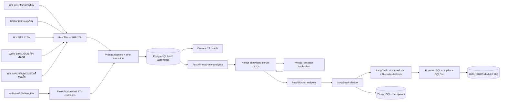
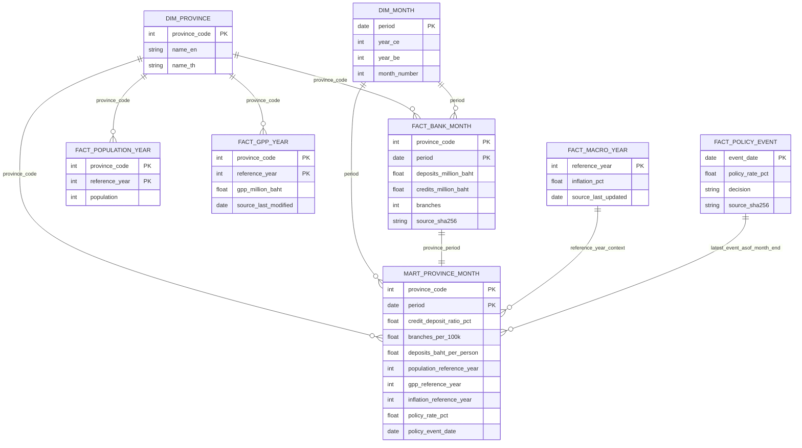
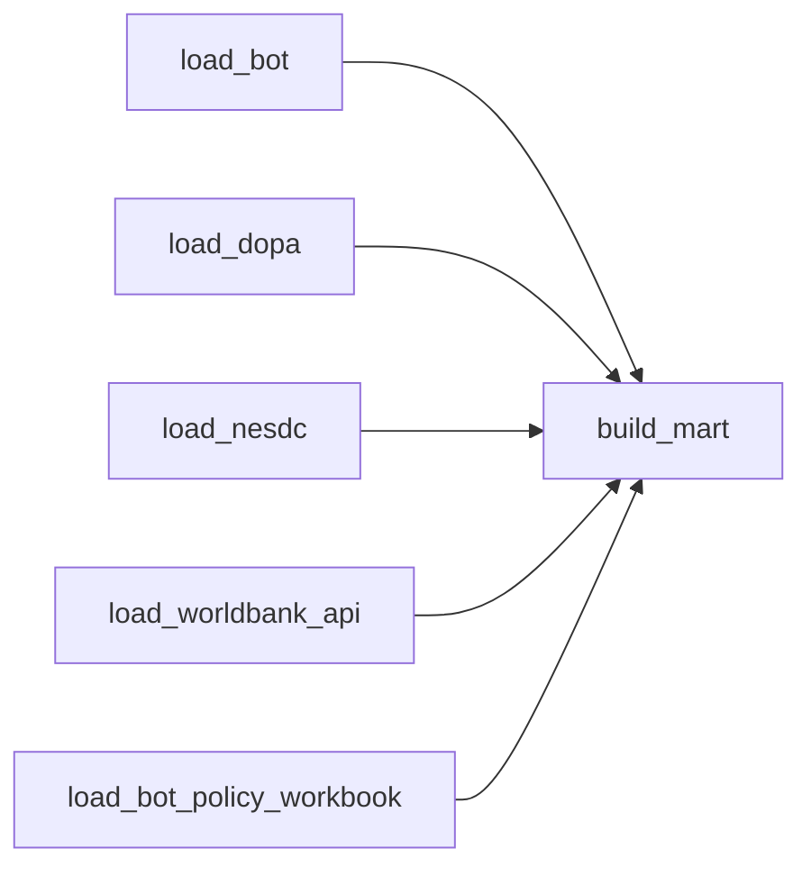

# Architecture & Data Warehouse Design

หลักการ: จังหวัดเป็น crosswalk แบบตรวจมือ 77 code, ไม่ใช้ fuzzy match; แยก grain จังหวัด–เดือนจากจังหวัด–ปีและประเทศ–ปี; ค่า annual เป็น context ล่าสุดที่ทราบตามกติกา availability ไม่ใช่ข้อเท็จจริงรายเดือน. `NULL` หมายถึงไม่มี/ยังใช้ไม่ได้. `source_manifest` และ `etl_run` ผูก provenance และผลรัน แต่ไม่ใช่ fact เชิงธุรกิจ

Airflow DAG ไม่สร้างค่ารายวันจากชุดรายเดือน: รันทุกวันเพื่อตรวจการเผยแพร่หรือ revision และโหลด fact ตามงวดต้นฉบับ การตั้งเวลาใช้ timezone Asia/Bangkok; metadata ของ Airflow อยู่ PostgreSQL ฐาน `airflow` แยกจากฐาน `bank`

## Next.js application boundary

`frontend/` contains Next.js App Router pages, TypeScript contracts, locally hosted Thai fonts, shared charts/tables and responsive navigation. Browsers call same-origin `/api/*`; the Next.js server forwards only an allowlist of read endpoints and `/chat` to FastAPI. It does not forward ETL endpoints, provider credentials, database DSNs or arbitrary destinations. `API_BASE_URL` is server-only. Docker binds the web service to `127.0.0.1:3000`.

Analytical reads use `bank_reader`, explicit read-only transactions and a ten-second statement timeout. Month inputs must exist in the warehouse. CQ queries are scoped to data no later than the selected month; PostgreSQL bound parameters remain visible alongside the actual executed SQL. Comparison requests accept at most four province codes. Source views omit raw paths and ETL error detail. Next.js is the sole application frontend.

World Bank's current source-revision date is not an archived publication vintage. A newly updated API dataset can therefore be ineligible for all earlier banking months under the conservative no-lookahead rule. The application shows unavailable inflation honestly rather than inventing an earlier availability date. Reconstructing archived vintages is a separate future data-engineering task.

## Conversational analytics boundary

The assistant resolves known Thai analytical wording deterministically and optionally sends unresolved paraphrases to a LangChain structured planner. A decision may request clarification or reject unsupported data; only a validated `QueryPlan` reaches the SQL compiler. LangGraph persists confirmed context, pending clarification and bounded history per session. Ranking universes are counted before LIMIT; YoY uses same-month prior-year joins. Multi-metric charts keep units separate and province trends use distinct series. See [formulas, memory, execution limits and the 80-question evaluation](chatbot-analytics.md).

The active planner contract is v3. Request-local ContextVars collect numeric provider usage and timing; `ask()` emits allowlisted JSON telemetry with no question/session ID/key/raw error. Local Docker logs can be aggregated with `tools.observe_chat`. A separate live comparison calls the same planner/executor/answer functions using isolated in-memory predicted contexts, leaving users' persisted checkpoints intact. See [LLM evaluation and observability](llm-evaluation.md).
## Conversation routing

The chat graph enters `conversation` before `plan`. Gemini selects a bounded action; safety-gated and offline fallback routes remain available. Analytical actions use the existing validated planner/compiler and read-only SQL. Capabilities, greetings and explanations skip execution. Presentation copies the last confirmed result and changes only the chart. The UI labels router and planner separately. See [routing design and live smoke evidence](conversation-routing.md); earlier planner evaluation scores do not evaluate this layer.
