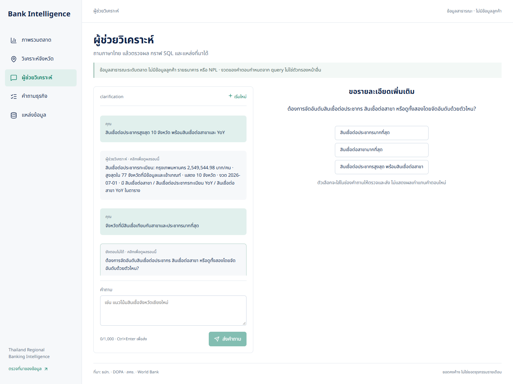
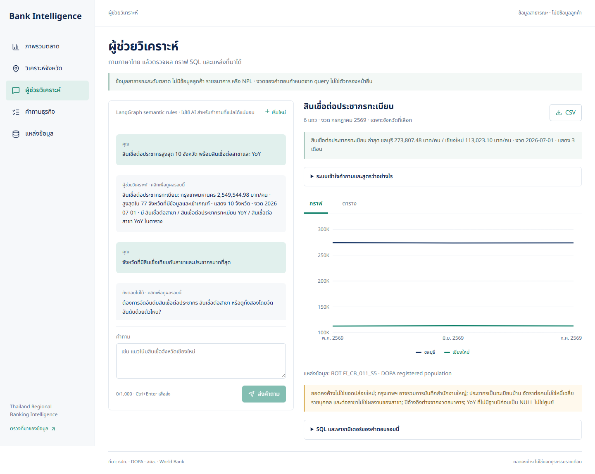

# Conversational banking analytics

Implemented and verified locally on 11 October 2026 (Asia/Bangkok). This is a constrained analytical assistant over real public data, not an unrestricted SQL agent or a banking adviser.

## Business purpose

Absolute loan balances mostly highlight Bangkok. Market-screening users also need scale-adjusted measures, comparable provinces and growth context. The assistant therefore distinguishes **total loans**, **loans per registered resident**, and **loans per branch** instead of answering all three with the same ranking. A high ratio is a reason to investigate, not evidence of unmet demand or branch profitability.

## Measures and calculation contract

All balances are month-end stocks; the system never sums them across months. Ratios use the aggregate numerator divided by the aggregate denominator, not an average of provincial ratios.

| Metric key | Calculation / unit |
|---|---|
| `credits`, `deposits` | Banking balances; THB million |
| `branches` | Branch count |
| `credit_deposit_ratio` | Loans / deposits × 100; % |
| `branches_per_100k` | Branches / registered population × 100,000 |
| `credits_per_person`, `deposits_per_person` | Balance × 1,000,000 / registered population; THB/person |
| `credits_per_branch` | Loans / branches; THB million/branch |
| `gpp` | Available annual provincial GPP; THB million, not monthly production |
| `policy_rate` | National month-end policy rate; %, not province-specific |
| `credits_yoy_pct`, `deposits_yoy_pct`, `branches_yoy_pct` | Same-month prior-year growth; % |
| `credits_per_person_yoy_pct`, `credits_per_branch_yoy_pct` | Same-month prior-year growth of the corresponding ratio; % |

The catalogue has 15 metrics. Undefined/zero denominators and missing prior-year observations stay unavailable, not zero growth. Population and GPP reference years remain visible in result rows. Per-person loans are **not individual debt**; per-branch loans are **not branch performance**. Bangkok may reflect head-office booking.

## Query capabilities

- Rankings count all eligible provinces **before** limiting displayed rows. Showing ten rows does not mean the winner ranked against only ten provinces. Ties use SQL `RANK`, with province code for stable display order.
- A primary metric determines ranking; up to six additional explicit metrics may be requested, with eligible YoY measures added alongside them. Ambiguous sorting or denominators trigger clarification.
- Filters include selected month/range, up to four exact provinces, Bangkok exclusion, minimum registered population, loan balances, GPP and maximum branch density. Strict `>` and inclusive `>=` are distinguished; financial units are converted before filtering.
- Province comparisons are labelled comparisons, not national rankings. Trends retain monthly observations and support multiple province series. Unknown or unavailable periods are rejected instead of silently switching to the latest month.
- Unsupported NPL, customer data, individual-bank performance, lending approvals and forecasts do not get invented answers.

Try these questions in order:

1. `สินเชื่อต่อประชากรสูงสุด 10 จังหวัด พร้อมสินเชื่อต่อสาขาและ YoY`
2. `ไม่เอากรุงเทพฯ`
3. `เอา 5 อันดับ แล้วเทียบกับปีก่อน`
4. `ทำกราฟแท่งให้หน่อย`

Or start a new conversation with `แนวโน้มสินเชื่อต่อประชากรเชียงใหม่และชลบุรีย้อนหลัง 3 เดือน`. The intentionally ambiguous `จังหวัดที่มีสินเชื่อเทียบกับสาขาและประชากรมากที่สุด` prompts the user to choose the intended ratio.

## Planner, conversation and execution

```text
Question + confirmed session context
  → safety gate / bounded conversational router
  → analytical action: Thai semantic parser
  → structured LLM fallback when the parser cannot resolve the wording
  → ready QueryPlan OR clarification / unsupported
  → allowlisted SQL compiler → SQLGlot validation → read-only transaction
  → deterministic answer + result rows + units + SQL + provenance
```

The conversational router selects guidance, clarification, explanation, presentation, refusal, or analytics. Non-analytical actions skip SQL. See [routing behavior and service checks](conversation-routing.md). Router provider and analytical planner mode are labelled separately: a rules-generated plan can still follow a Gemini routing call. Unresolved analytical paraphrases can use LangChain structured output with Gemini (preferred) or the optional OpenAI provider. The model emits a validated decision and `QueryPlan`, **not arbitrary SQL**. Provider failures are redacted; a failed or ambiguous turn does not replace the last confirmed context or show old results as its new answer.

LangGraph checkpoints are persisted in PostgreSQL by session ID. Follow-ups inherit the confirmed metric, filters and resolved banking period; standalone questions can start a new analytical scope. Pending clarification preserves its own explicit scope. The graph retains the last 20 history messages, and the provider prompt receives at most the last eight. These bounds limit conversational context, not database retention. Starting a new conversation generates a new session ID; it does not delete old checkpoints. This local prototype has no authenticated ownership or retention administration.

Execution uses bound parameters, an allowlisted mart, one read-only SELECT, the `bank_reader` role and a ten-second statement timeout. Ranking/lookup queries return at most 77 rows; bounded trends return at most 77 periods × four province series = 308 rows. The current warehouse contains 25 months. A national policy-rate trend is not duplicated into province-level interpretations.

Official references: [LangGraph memory](https://docs.langchain.com/oss/python/langgraph/add-memory) and [LangChain structured output](https://docs.langchain.com/oss/python/langchain/structured-output).

## UI contract

The assistant shows actual period, scope, units, formulas, ranking universe, SQL and parameters. Multiple metrics have a selector so THB/person, THB million/branch and percentages are **not combined on one axis**. Time comparisons use separate province series; cross-sectional rankings use bars. Tables and CSV retain all requested metrics. Clarification buttons populate an editable question for the user to review and send. The mobile view separates conversation and results.






## Evaluation and evidence

The versioned [80 Thai golden questions](../tests/fixtures/chat_cases.json) contain 70 executable cases, five clarification cases and five unsupported cases. Each records expected plan fields or expected refusal/clarification. [Database-backed tests](../tests/test_chat_analytics.py) additionally calculate expected results independently from raw mart rows: Python arithmetic checks ratios, prior-year alignment, weighted national results, filters, ranking universe and order. The oracle does not reuse the SQL compiler or its metric formulas. Conversation tests cover clarification resolution, context preservation, isolation, reset and stale-result prevention; mock-provider tests cover structured decisions.

Local verification on 11 October 2026:

- Current full suite: **170 passed**, including conversation routing. The earlier analytics-only and planner-evaluation snapshots recorded 131 and 143 tests respectively.
- Offline golden evaluator: **80/80 status, plan and result checks passed**. This tests the deterministic path on this fixed corpus, **not 100% natural-language or LLM accuracy**.
- TypeScript check and Docker Next.js production build passed; rebuilt `api` and `web` were running against healthy PostgreSQL.
- One **live Gemini fallback** request (`ช่วยดูยอดออมตามเดือนหน่อย`) succeeded in structured LLM mode, returning a national deposit trend over 25 months. This is a smoke test only; OpenAI was not tested live.
- Browser checks: multi-metric response and metric selector/table, denominator clarification and choice submission, Bangkok-exclusion follow-up (77 → 76 eligible provinces), five-row/YoY follow-up, new conversation, two-province trend and unsupported NPL refusal. At 390 × 844, document width was 390 pixels with no horizontal page overflow; browser console reported zero errors/warnings. Screenshots were captured from the running application with Playwright before the subsequent conversation-router change.

At this verification, Compose showed only `postgres`, `api` and `web` running. Airflow/Grafana were not started as part of the chatbot upgrade; no scheduler continuity is claimed from this check.

Reproduce locally from the project root:

```powershell
.\.venv\Scripts\python.exe -m pytest -q
.\.venv\Scripts\python.exe -m tools.evaluate_chat
cd frontend
npm run typecheck
npm run build
```

Optional provider evaluation, from the project root:

```powershell
# Requires your locally configured provider key; sends up to five external requests.
.\.venv\Scripts\python.exe -m tools.evaluate_chat --live --limit 5
```

`--live` is explicit because it can consume API quota and transmit public-data questions/context. Increasing to the entire original 80-question corpus is a separate live benchmark; that full-corpus live evaluation is not claimed here. A later [24-turn live comparison](llm-evaluation.md) measures all three strategies with development and held-out splits, before/after improvements and operational telemetry. Results change when the warehouse updates, so the independent oracle derives expected numbers from the current snapshot rather than freezing outdated banking values.

## Remaining limitations

Thai wording outside the corpus may require clarification or the LLM fallback. There is no automatic forecasting, causal attribution, private data access or autonomous multi-step SQL exploration. Annual-only GPP is not presented as a monthly time series. Continuous Airflow operation must be proven separately by actual scheduler history; these tests and the historical warehouse do not prove one month of operation. Authentication, rate limits, audit/retention policies and production deployment hardening remain separate work.
