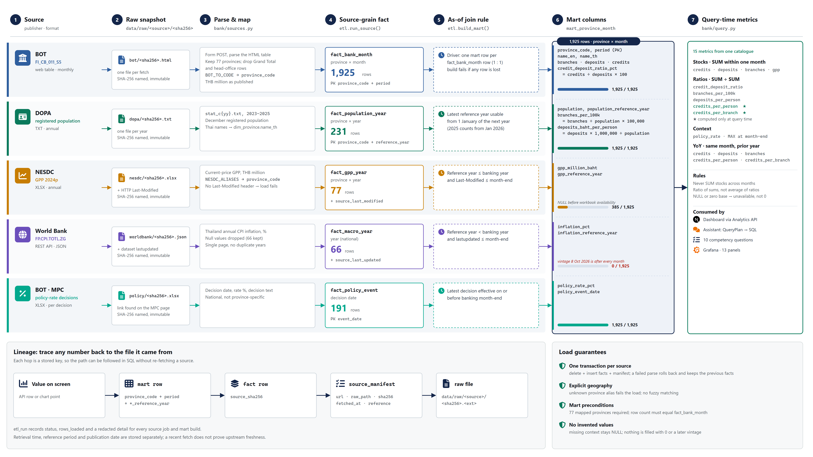

# Data sources and integration contract

[Documentation index](README.md) · [Architecture](architecture.md)

Counts below were checked against the local warehouse on **11 October 2026 (Asia/Bangkok)**. They describe an imported snapshot, not guaranteed current provider coverage.

## Source catalogue

| Dataset | Actual access method | Source grain / loaded coverage | Analytical role |
| --- | --- | --- | --- |
| [BOT FI_CB_011_S5](https://app.bot.or.th/BTWS_STAT/statistics/BOTWEBSTAT.aspx?language=ENG&reportID=1008) | Public web table, HTTP GET/form POST; not a REST API | Province–month; 77 × 25 = 1,925 rows | Loans/deposits in THB million, branches |
| [DOPA population](https://stat.bora.dopa.go.th/new_stat/webPage/statByYear.php) | Official TXT downloads | Province–year; 231 rows, 2023–2025 | December registered population |
| [NESDC GPP 2024p](https://www.nesdc.go.th/en/download/table-of-gross-regional-and-provincial-product-2024-excel/) | Official XLSX workbook | Province–year; 77 rows | Current-price provincial GPP in THB million |
| [World Bank FP.CPI.TOTL.ZG](https://api.worldbank.org/v2/country/THA/indicator/FP.CPI.TOTL.ZG?format=json&per_page=100) | Public JSON REST API; no key | Thailand–year; 66 non-null source observations | National annual CPI inflation context |
| [BOT MPC decisions](https://www.bot.or.th/en/our-roles/monetary-policy/mpc-publication/policy-interest-rate.html) | Official XLSX workbook; not the authenticated policy-rate API | Decision date; 191 events | National month-end policy rate |

The adapters are in [sources.py](../bank/sources.py); transactional loading and mart construction are in [etl.py](../bank/etl.py). No customer-level or individual-bank records are ingested.

## Data flow and lineage

Each lane follows one source through seven stages. The bar in the mart column shows how many of the 1,925 province-month rows receive that source's context under the as-of rule; the sections below explain each rule and gap. The lineage band shows the stored keys that lead from a displayed value back to its raw file. Open the [SVG version](design/data-flow.svg) to zoom; the diagram is generated by `tools/presentation/data_flow.js`.

## Geographic mapping

[provinces.py](../bank/provinces.py) maps reviewed BOT/NESDC aliases to all 77 DOPA province codes. Names such as `Chiengmai` and `Chiang Mai` resolve through explicit aliases, not fuzzy matching.

Aggregate and non-province rows, including Grand Total and head-office categories, are excluded rather than added to provincial observations. Unknown names fail validation. The province–month key must stay unique; joins must not multiply banking balances.

## Temporal joins

Banking periods are stored as the first day of the reporting month, while balances represent that month's closing stocks.

| Context | Eligibility rule |
| --- | --- |
| DOPA population | Latest December reference year usable from 1 January of the following year |
| NESDC GPP | Latest eligible reference year with observed workbook `Last-Modified` no later than banking month-end |
| World Bank inflation | Latest reference year strictly before the banking year, with dataset `lastupdated` no later than banking month-end |
| Policy rate | Latest decision date no later than banking month-end |

Availability metadata is a conservative floor, **not proof of the original historical publication date for every observation**. The project does not reconstruct archived publication vintages. Provider revisions can change usable historical context on a later rebuild.

## Observed missing context

For the July 2024–July 2026, 1,925-row snapshot:

- Registered population is available in all rows.
- GPP is unavailable in **1,540 rows** before the observed workbook availability date; July 2026 uses GPP 2024p.
- Inflation is unavailable in **all 1,925 rows** because the observed World Bank vintage is **8 October 2026**, later than every banking period.
- The policy table can contain events after the latest banking month; the mart still uses only decisions effective by that month-end.

Source ingestion success therefore does not imply every source can be joined into every historical month. Missing and undefined values remain `NULL`; they are not replaced with zero.

## Units and aggregation

- Loans/deposits: THB million; multiply by 1,000,000 for THB/person.
- Branches: count; population: registered persons; policy/inflation: percent.
- Monthly stocks may be summed across provinces in one month, **not across months**.
- Aggregate ratios use summed numerators/denominators, not averaged provincial ratios.
- YoY uses the same month of the previous year. Missing/zero bases remain unavailable.

BOT province values are rounded independently. In the recorded July 2026 snapshot, provincial deposits total 18,136,237 million THB and differ from the independently rounded Grand Total by 4 million THB.

## Provenance and freshness

Raw files are content-addressed with SHA-256. `source_manifest` stores URL, retrieval time, reference metadata, and the raw path; `etl_run` stores outcomes. The public API omits internal paths and raw error details.

Retrieval time, reference period, and source publication/revision date are distinct. A recent successful retrieval does not independently prove that an upstream dataset is current. The sources page exposes those distinctions instead of assigning unsupported freshness badges.

Third-party datasets retain their own source definitions and published usage terms. The repository's ingestion code does not establish a separate license for provider data.
