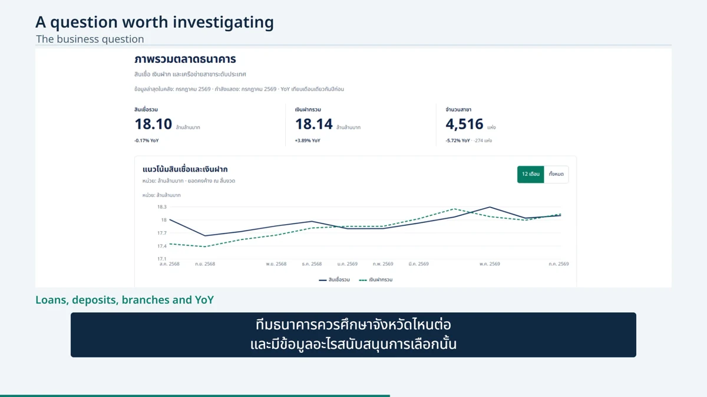
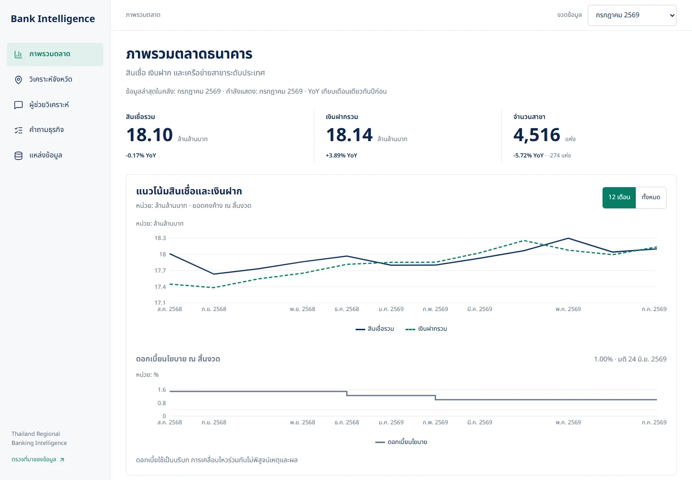
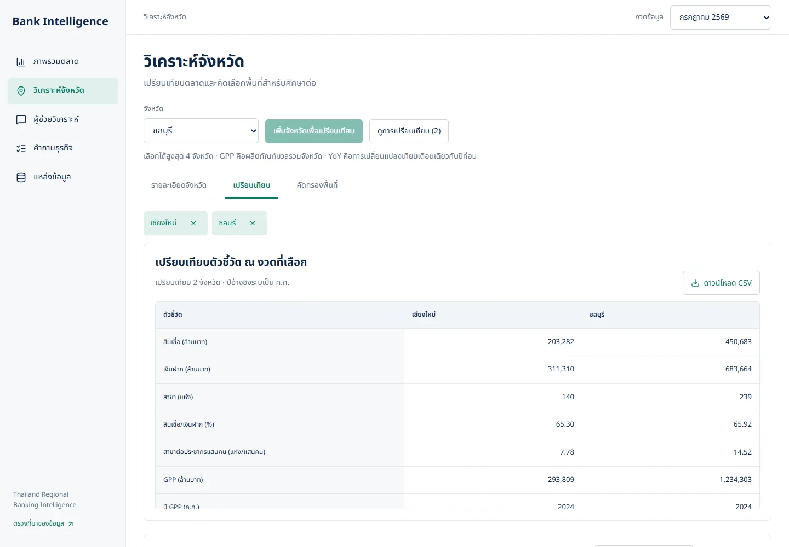
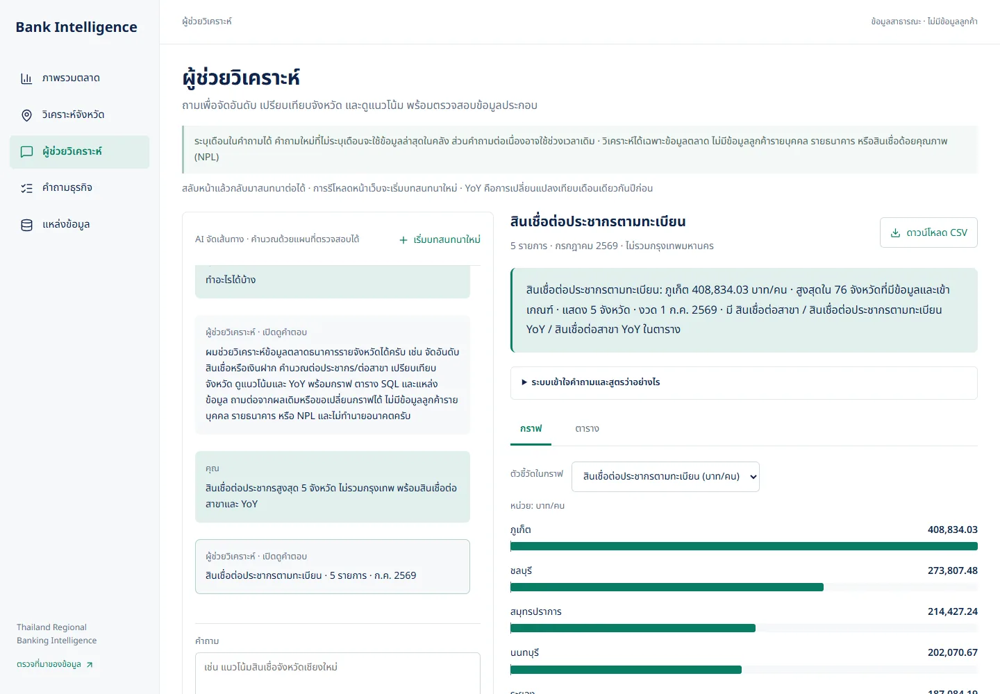
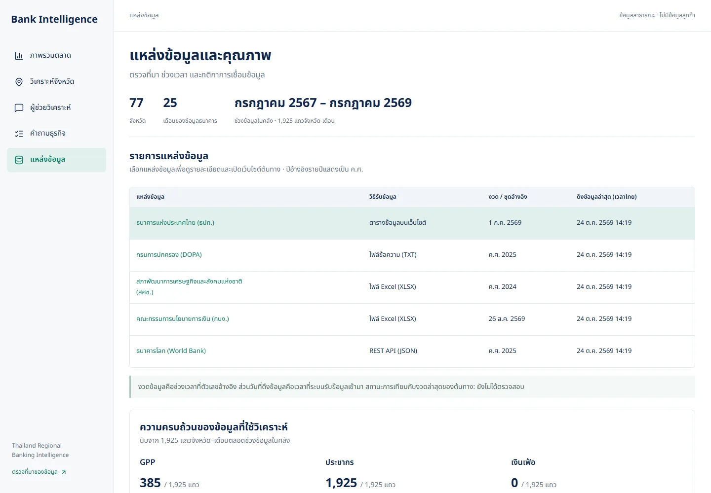
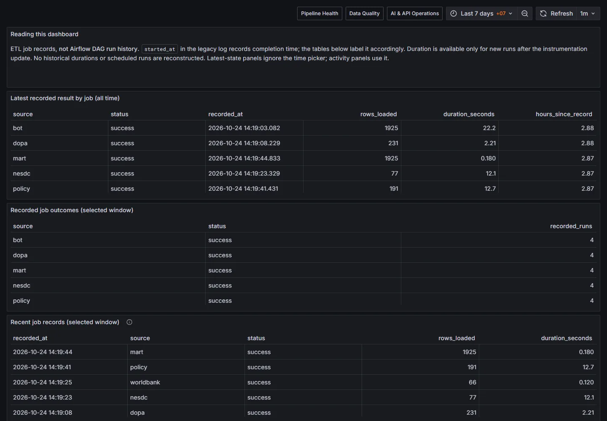
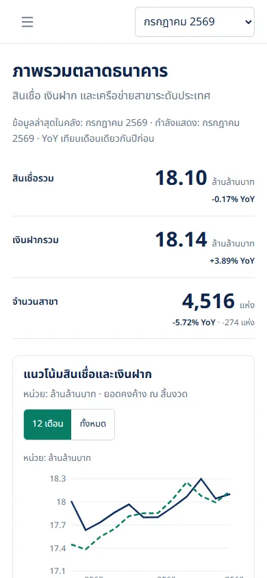
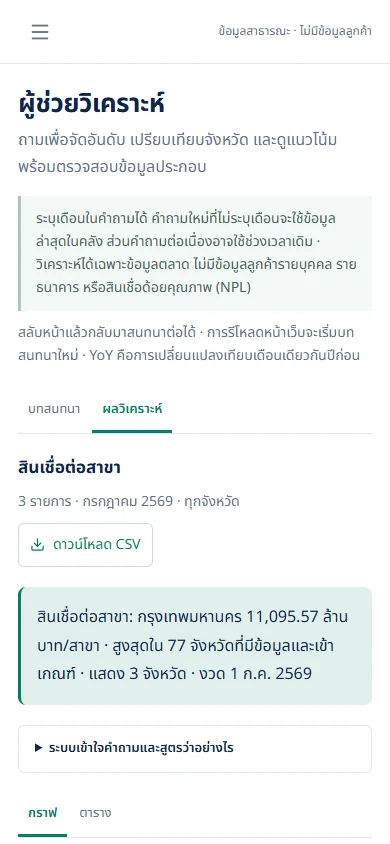

# Feature walkthrough

Actual application captures from **24 October 2026**, covering the public-data analytical workflow and its operational tools. Screenshots are compressed WebP images; the full-resolution masters and browser recordings are maintained outside Git.

## Video

The current **4 minute 40 second walkthrough** uses English narration and burned-in Thai subtitles, edited and rendered with HyperFrames from actual application recordings and verified captures. It includes 30 narration scenes in 12 chapters and 69 distinct captured interface states, including recording inserts from seven source files. Close views and reading holds support inspection; this is an edited walkthrough rather than one continuous session. The film records the local build on its capture date; see the [provider and routing contract](conversation-routing.md) for the current assistant behavior.

**Repository video:** [open or download the MP4](media/bank-intelligence-walkthrough-en-th.mp4). The final video is stored directly in Git alongside this guide; no separate video-hosting account is required. GitHub/browser behavior determines whether the file previews or downloads.

| Start | Chapter |
| --- | --- |
| 00:00 | The business question |
| 00:13 | Market overview |
| 00:33 | Province detail |
| 00:40 | Province comparison |
| 00:57 | Opportunity screening |
| 01:16 | AI analysis |
| 01:39 | Conversation and context |
| 02:09 | Ten business questions |
| 02:59 | Sources and lineage |
| 03:37 | Operational monitoring |
| 03:58 | Pipeline orchestration |
| 04:16 | Mobile and conclusion |

Sidecars: [Thai SRT](media/bank-intelligence.th.srt), [Thai WebVTT](media/bank-intelligence.th.vtt), [English SRT](media/bank-intelligence.en.srt), [English WebVTT](media/bank-intelligence.en.vtt). Thai subtitles are already visible in the picture; the MP4 also contains an optional English subtitle track.

The earlier silent 2:06 desktop compilation and 11-second mobile source export are retained locally. The final narrated MP4 is versioned in `docs/media/`; editable source, earlier silent exports and full-resolution masters remain outside Git. See [video verification](evidence/narrated-video-qa-2026-10-24.md) for corrected captures, full-file decoding, loudness measurements and the limits of audio review.

## Product walkthrough

### 1. Market overview

Review loan/deposit balances and branches for a selected bank-data month, then inspect trends and concentration. Search and download are demonstrated against actual warehouse results.

Additional captures: [all months](../output/playwright/demo-overview-all-months.webp), [search and concentration](../output/playwright/demo-overview-search-concentration.webp), [methodology](../output/playwright/demo-overview-methodology.webp).

### 2. Province analysis and screening

Compare absolute balances with normalized measures before selecting areas for further investigation. Screening thresholds identify candidates, not approved branch expansion decisions or credit recommendations.

| Workflow | Captured states |
| --- | --- |
| Province detail | [Detail and metric selection](../output/playwright/demo-province-detail.webp) |
| Comparison | [Index-100 trend](../output/playwright/demo-comparison-index.webp), [four provinces](../output/playwright/demo-comparison-four-provinces.webp) |
| Scatter | [Selected provinces](../output/playwright/demo-comparison-scatter-selected.webp), [all provinces](../output/playwright/demo-comparison-scatter-all.webp) |
| Screening | [Default candidates](../output/playwright/demo-screening.webp), [custom thresholds](../output/playwright/demo-screening-custom.webp), [empty result](../output/playwright/demo-screening-empty.webp), [comparison hand-off](../output/playwright/demo-screening-to-comparison.webp) |

### 3. Analytical assistant

The recording uses the configured **Groq / `openai/gpt-oss-20b`** provider. Analytical results come from validated plans and bounded database queries; model responses are not accepted as numerical evidence by themselves.

| Capability | Captured evidence |
| --- | --- |
| Discover supported tasks | [Capabilities answer](../output/playwright/demo-assistant-capabilities.webp) |
| Explain metric and query | [SQL and interpretation](../output/playwright/demo-assistant-sql.webp) |
| Multiple metrics and CSV | [Results table](../output/playwright/demo-assistant-multiple-metrics.webp) |
| Contextual limit/filter | [Top-three follow-up](../output/playwright/demo-assistant-limit-followup.webp), [explicit population filter](../output/playwright/demo-assistant-filter-followup.webp) |
| Explain latest result | [Explanation](../output/playwright/demo-assistant-explanation.webp) |
| Ask for clarification | [Ambiguous denominator](../output/playwright/demo-assistant-clarification.webp), [resolved request](../output/playwright/demo-assistant-clarification-resolved.webp) |
| Respect data boundaries | [Unsupported NPL request](../output/playwright/demo-assistant-unsupported.webp) |
| Compare trends and YoY | [Province trend](../output/playwright/demo-assistant-comparison-trend.webp) |
| Change presentation | [Table view](../output/playwright/demo-assistant-presentation.webp) |
| Navigate and reset | [Context retained](../output/playwright/demo-assistant-navigation-context.webp), [new conversation](../output/playwright/demo-assistant-reset.webp) |

**Observed limitation:** after a multi-metric question, the terse follow-up “ประชากรเกิน 1 ล้านคน” produced a generic clarification rather than applying the population filter. Restating the metric and threshold explicitly worked in the captured session. This is a conversation-routing limitation, not a provider outage. Successful demonstrations do not establish held-out accuracy; see [LLM evaluation](llm-evaluation.md) for the separate evaluation methodology and results.

### 4. Ten competency questions

Each link opens the actual selected CQ view. Question wording, formulas and analytical interpretation are documented in [Competency questions](competency-questions.md) and [Business findings](business-report.md).

| Questions | Captures |
| --- | --- |
| CQ01–CQ05 | [CQ01](../output/playwright/demo-cq01.webp) · [CQ02](../output/playwright/demo-cq02.webp) · [CQ03](../output/playwright/demo-cq03.webp) · [CQ04](../output/playwright/demo-cq04.webp) · [CQ05](../output/playwright/demo-cq05.webp) |
| CQ06–CQ10 | [CQ06](../output/playwright/demo-cq06.webp) · [CQ07](../output/playwright/demo-cq07.webp) · [CQ08](../output/playwright/demo-cq08.webp) · [CQ09](../output/playwright/demo-cq09.webp) · [CQ10](../output/playwright/demo-cq10.webp) |
| Query transparency | [SQL view](../output/playwright/demo-cq-sql.webp) |
| Insufficient history | [Historical empty state](../output/playwright/demo-cq-historical-empty.webp) |

### 5. Sources, coverage and temporal joins

The captured warehouse contains **77 provinces × 25 months = 1,925 province-month rows**, July 2024–July 2026. The five datasets come from four institutions: BOT supplies banking and policy-rate data. Retrieval time is not the observation period or proof that the upstream source has no newer release.

| Evidence | Captures |
| --- | --- |
| Five dataset details | [BOT banking](../output/playwright/demo-source-bot.webp), [DOPA population](../output/playwright/demo-source-dopa.webp), [NESDC GPP](../output/playwright/demo-source-nesdc.webp), [BOT policy rate](../output/playwright/demo-source-policy.webp), [World Bank inflation](../output/playwright/demo-source-worldbank.webp) |
| Coverage and provenance | [Coverage](../output/playwright/demo-source-coverage.webp), [lineage and hashes](../output/playwright/demo-source-lineage.webp) |
| Point-in-time joins | [Temporal rules](../output/playwright/demo-source-temporal-joins.webp) |
| Ingestion history | [ETL records](../output/playwright/demo-etl-history.webp) |

Population covers all 1,925 rows; GPP is available for 385 rows. World Bank inflation was ingested but remains unavailable in all 1,925 analytical rows under the current vintage-availability rules. Missing values are not filled with future information merely to populate charts.

### 6. Operational monitoring

| Tool | Captures |
| --- | --- |
| Grafana Pipeline Health | [Overview](../output/playwright/demo-grafana-pipeline.webp), [details](../output/playwright/demo-grafana-pipeline-details.webp) |
| Grafana Data Quality | [Overview](../output/playwright/demo-grafana-data-quality.webp), [details](../output/playwright/demo-grafana-data-quality-details.webp) |
| Grafana AI & API Operations | [Overview](../output/playwright/demo-grafana-ai-operations.webp), [details](../output/playwright/demo-grafana-ai-operations-details.webp) |
| Airflow | [Run grid](../output/playwright/demo-airflow-grid.webp), [task graph](../output/playwright/demo-airflow-graph.webp), [run details](../output/playwright/demo-airflow-run-details.webp) |

Monitoring was captured read-only: no DAG trigger, backfill or status change was performed for the recording. The selected successful run is `scheduled__2026-10-23T00:00:00+00:00`. One successful run and warehouse history do **not** prove a full month of uninterrupted daily scheduling. Grafana ETL records and Airflow DAG run history are distinct evidence sources.

### 7. Mobile views

| Overview | Assistant |
| --- | --- |
|  |  |

Additional views: [navigation](../output/playwright/demo-mobile-navigation.webp), [comparison](../output/playwright/demo-mobile-comparison.webp), [conversation](../output/playwright/demo-mobile-conversation.webp), [business questions](../output/playwright/demo-mobile-questions.webp), [sources](../output/playwright/demo-mobile-sources.webp).

## Evidence boundaries

- This catalogue documents selected working flows on a dated local deployment, not an exhaustive browser/accessibility test suite or production-readiness certification.
- Recorded LLM responses are integration demonstrations, not new benchmark scores. The terse-filter limitation above remains open.
- Source vintages differ. Missing context and historical empty states are retained rather than disguised.
- No customer-level or individual-bank data is present. Authentication screens, credentials and raw authenticated sessions are excluded from the published images.
- Private masters, temporary browser profiles and video exports are not committed. Only the 66 compressed documentation images belong in the repository.
